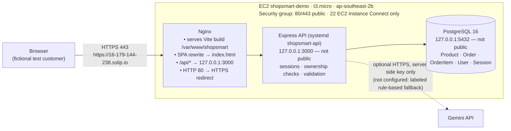

# ShopSmart AWS Deployment — Single EC2 Host

**Release:** `aws-deploy` branch · **Region:** Asia Pacific (Sydney) `ap-southeast-2` · **Release type:** Hosted (online), fictional data and simulated checkout only
**Public URL:** https://16-179-144-238.sslip.io
**Prepared by:** Andrik Brenth Canlas (BSIT 4-A) · 20 November 2026

---

## 1. Account plan and cost ownership

| Decision | Value | Evidence |
|---|---|---|
| Account plan | AWS **Free plan** (credits only; no charges while on the Free plan) | Redacted Console Home "Cost and usage" widget |
| Credits | US$110.70 remaining on 20 Nov 2026 | Console Home / Free Tier page |
| Plan expiry | 171 days remaining — ends **8 May 2027** | Console Home |
| Enabled Region | Only `ap-southeast-2` (Sydney) is enabled by the organization's service control policy | AWS Global View |
| Expected duration | Demo from 20 Nov 2026; remove by **15 Dec 2026** (tag `RemoveBy`) | Resource register below |
| Root account | Not used. Signed in through the organization-provided `AccountFullAccessRole` (federated sign-in); no root or access keys shared | Console account menu |

"Free tier eligible" was not treated as "free": the public IPv4 address, the EBS volume, and instance hours above the shared 750 h/month (the account also runs `asktala`) all draw from credits. Estimated: about US$0.30–0.45/day.

## 2. Resource register

| Service | Resource | Region | Owner | Purpose | Created | Planned removal |
|---|---|---|---|---|---|---|
| EC2 instance | `shopsmart-demo` `i-055fca61871c712be`, t3.micro, Ubuntu 24.04 | ap-southeast-2b | Andrik Canlas | Nginx + Express API + PostgreSQL | 2026-11-20 | 2026-12-15 (terminate) |
| EBS volume | `shopsmart-demo-root`, 20 GiB gp3, encrypted, delete-on-termination | ap-southeast-2b | Andrik Canlas | OS, app, PostgreSQL data | 2026-11-20 | Deleted with instance |
| Security group | `shopsmart-web-sg` `sg-062e74d9cb110993c` | ap-southeast-2 (default VPC) | Andrik Canlas | 80/443 public, 22 from EC2 Instance Connect only | 2026-11-20 | 2026-12-15 (after instance) |
| Public IPv4 | 16.179.144.238 (auto-assigned, not an Elastic IP) | ap-southeast-2 | Andrik Canlas | Public address; released when the instance stops/terminates | 2026-11-20 | With instance |
| TLS certificate | Let's Encrypt for `16-179-144-238.sslip.io` (90 days, auto-renew) | on instance | Andrik Canlas | HTTPS | 2026-11-20 | With instance |

Not ShopSmart (left untouched): `asktala` instance `i-0d51d4432a0991ed1` (t3.small), its VPC/security groups, one Elastic IP and two S3 buckets.

**Removal plan:** after grading, `aws ec2 terminate-instances --instance-ids i-055fca61871c712be`, wait for `terminated`, then `aws ec2 delete-security-group --group-id sg-062e74d9cb110993c`. Confirm in EC2 Global View that no `Project=ShopSmart` resource remains. The database lives on the instance volume, so terminating deletes all demo data (acceptable: fictional data only).

## 3. Architecture decision record

**Decision:** Single EC2 host (Nginx + Express + PostgreSQL on one Ubuntu 24.04 t3.micro).

**Why:** a short classroom demo with fictional data; fewer services to configure and pay for; one place to read logs; fits Free plan credits. The Amplify + EC2 + RDS layout was rejected for this demo because it adds a second HTTPS endpoint, CORS with credentials across origins, and a separately billed RDS instance.

**Accepted risks and what the team now owns:** one machine is a single point of failure; we maintain OS patches, the Node process (systemd), PostgreSQL backups (none for this demo — data is fictional and disposable), HTTPS renewal (certbot timer), and cleanup. If the instance is stopped and started, its public IP and therefore the `sslip.io` hostname change, and the certificate and `FRONTEND_URL` must be re-issued (re-run `bootstrap.sh`).

**What would change for a real online release:** managed RDS in a private subnet with automated backups, an Elastic IP or load balancer with a real domain, a separate secrets store (SSM Parameter Store / Secrets Manager), and at least two instances.

### Deployment diagram

**Trace one request:** browser → `GET https://…/api/products` → Nginx (443) → Express (127.0.0.1:3000) → PostgreSQL (127.0.0.1:5432) → JSON → React renders cards. Because the frontend and API share one HTTPS origin, there is no mixed content and no cross-origin cookie problem.

### Ports

| Port | Exposure | Why |
|---|---|---|
| 443 | Public | Only real entry point (frontend + `/api`) |
| 80 | Public | Redirects to 443; Let's Encrypt HTTP-01 validation |
| 22 | EC2 Instance Connect prefix list `pl-0e1bc5673b8a57acc` only | Admin access without a downloaded key file |
| 3000 | Not opened; bound to 127.0.0.1 | Raw Express port stays internal behind Nginx |
| 5432 | Not opened; PostgreSQL listens on localhost | The browser never talks to the database |

## 4. Configuration and secrets

| Setting | Where | Value class |
|---|---|---|
| `VITE_API_URL=/api` | Build time (frontend bundle) | Public — same-origin path, no secret |
| `DATABASE_URL` | `/etc/shopsmart/api.env` (root:shopsmart, 0640) | **Secret** — password generated on the instance with `openssl rand`; never committed, printed or screenshotted |
| `FRONTEND_URL`, `HOST=127.0.0.1`, `TRUST_PROXY=1`, `COOKIE_SECURE=true`, `NODE_ENV=production`, `APP_VERSION` | `/etc/shopsmart/api.env` | Non-secret server settings |
| `GEMINI_API_KEY` | Not set | Would be server-only; UI labels answers as "Rule-based fallback — no live AI used" |

AWS identity (IAM / the instructor's federated role) controls who manages the EC2 resources. ShopSmart identity (User + Session tables, `shopsmart_session` cookie) controls which customer may read which order. These are separate.

## 5. Database, migrations and data preservation

| Migration | Change |
|---|---|
| `20260924094350_initial_schema` | Product, Order, OrderItem |
| `20261120090000_add_users_sessions_order_owner` | User, Session, nullable `Order.userId` (owner) with index and FK |

- Release uses `prisma migrate deploy` (applies committed migrations only). `migrate dev` is never run on the server.
- The starter `db:seed` **deletes orders and replaces products**, so it is never run on the server. The release runs `db:seed:initial`, which inserts the 6 sample products only when the Product table is empty and otherwise changes nothing.
- Existing orders created before sign-in existed keep `userId = NULL`; no customer can read them.

## 6. Release procedure

1. First boot: EC2 user data downloads `deploy/ec2/bootstrap.sh` from the `aws-deploy` branch and runs it (log: `/var/log/shopsmart-bootstrap.log`).
2. Later releases: connect with EC2 Instance Connect and run `sudo shopsmart-release` (fetch → `npm ci` → Prisma generate → Vite build → `migrate deploy` → `seed:initial` → copy build → restart API → health check).
3. Logs: `sudo journalctl -u shopsmart-api -n 100` (method, path, status, timing and request ID only — no bodies, cookies or secrets) and `/var/log/nginx/access.log`.

See section 7 of `docs/AWS_DEPLOYMENT_VERIFICATION.md` for the hosted check results.
